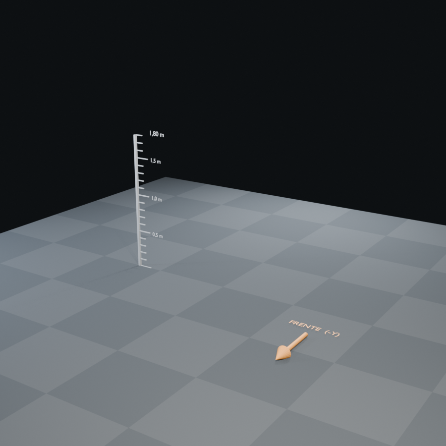

# Plantilla de Blender

Escena base para modelar personajes y props de DIGIWORLD ONLINE sin pelearse
con la escala ni la orientación.



## Abrir

Abre directamente `plantilla_digimon.blend` con Blender 5.2 o superior. Para
trabajar, guarda una copia en la carpeta de tu personaje:

```text
art-source/<personaje>/<personaje>_v01.blend
```

Nunca guardes encima de la plantilla.

## Qué incluye

| Colección | Contenido | ¿Se exporta? |
|---|---|---|
| `ENTREGA` | Tu modelo. Es la colección activa. | Sí |
| `REFERENCIA` | Suelo, regla de 1,80 m, flecha frontal | No |
| `ESTUDIO` | Cámara y tres luces de área | No |

- Unidades métricas, `1 unidad = 1 metro`.
- Suelo con cuadrícula de 1 × 1 m en `Z = 0`.
- Regla vertical con marcas cada 10 cm y etiquetas a 0,5 / 1,0 / 1,5 / 1,80 m.
- Flecha naranja que apunta hacia `-Y`, la dirección frontal del personaje.
- Cámara 3/4 con lente de 58 mm y tres luces de estudio.
- Render configurado en EEVEE a 900 × 900.
- Objeto vacío `ROOT_ENTREGA` en el origen, útil como raíz para personajes.
- Bloque de texto `LEEME` dentro del editor de texto con el checklist.

## Cómo usarla

1. Abre la plantilla y guarda una copia.
2. Modela en `ENTREGA`. Los objetos nuevos caen ahí automáticamente.
3. Usa la regla para comprobar la altura: un Rookie mide 1,5–1,9 m.
4. Orienta la cara y el pecho hacia `-Y`.
5. Antes de exportar: `Ctrl + A > All Transforms`.
6. Selecciona solo lo que quieras exportar y usa
   `File > Export > glTF 2.0 (.glb/.gltf)` con `Selected Objects` y `+Y Up`.

## Reglas que ya están puestas

- Pies apoyados en `Z = 0`.
- Origen entre los pies, en el centro.
- Personaje mirando hacia `-Y`.
- Escala real en metros.
- Colecciones separadas para no exportar luces, cámara ni suelo por error.

## Regenerar la plantilla

Si cambias el script, vuelve a generarla desde la raíz del repositorio:

```powershell
& "C:\Program Files\Blender Foundation\Blender 5.2\blender.exe" -b `
  --factory-startup `
  --python art-source/templates/crear_plantilla.py -- --render
```

El script escribe `plantilla_digimon.blend` y `plantilla_digimon.png` en esta
misma carpeta. Sin `--render` solo guarda el `.blend`.

## Notas

- La plantilla no contiene geometría de personaje; solo la puesta en escena.
- Si trabajas con un portátil sin teclado numérico, activa **Emulate Numpad** en
  `Edit > Preferences > Input`.
- Para texturas, usa rutas relativas o empaqueta los archivos antes de mover el
  `.blend`.
